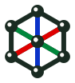

  

<h1 align="center">KNOTI</h1>

  <b>Parametric connectors for building geometric structures from rods</b> 
  <b>Parametrische Verbinder für Stabkonstruktionen und geometrische Körper</b>

  <a href="https://peterhausegger.github.io/KNOTI/"><b>Open the tool / Werkzeug öffnen</b></a> ·
  <a href="https://peterhausegger.github.io/KNOTI/galerie.html">Gallery / Galerie</a> ·
  <a href="https://creativecommons.org/licenses/by-sa/4.0/">CC BY-SA 4.0</a>

  <a href="#english">English</a> · <a href="#deutsch">Deutsch</a>

---

## English

KNOTI is a free browser tool for designing connectors ("nodes") that join rods into geometric structures: from a single star connector to a complete kit for a geodesic dome. You set a few values, KNOTI draws the parts and exports files for the laser cutter, the cutting plotter or the 3D printer.

### Try it

Open **https://peterhausegger.github.io/KNOTI/** in a current browser (Chrome, Edge, Firefox, Safari). Nothing to install, no account, no data is uploaded. The whole tool is one HTML file and also works offline: download `index.html` and open it locally.

### Three connector types

| Type | Production | Description |
|---|---|---|
| **Star** | laser cutter, plotter, scissors | Flat star, the arms are folded at the blue fold lines. Simple and light, good for cardboard, thin wood or plastic sheets. |
| **Cone** | laser cutter, plotter | Flat sector that is rolled into a cone. Stiffer and true to the spatial angles; not buildable at saddle points. |
| **3D node** | 3D printer | Printed body with collars. The rods go into holes, or tubes slide over pegs. Round or square profile, optional flat side with an embossed label for printing without supports. |

### Two modes

**Single connector:** one part with freely chosen number of arms, angles and arm lengths.

**Body:** a complete kit for a whole body, with one connector per corner, all rods and an assembly plan. Available bodies: tetrahedron, cube, octahedron, icosahedron, dodecahedron, geodesic sphere and dome (adjustable frequency), pyramid and frustum, box with angle, prism, antiprism, bipyramid, space grid, or your own **STL import**.

### Features

- **Construction with or without rods.** Without rods the arms of neighbouring connectors form the edges themselves (butting or overlapping).
- **Connection methods:** holes, pegs with barbs, hooks, cone seam, slot fold. Several can be combined.
- **Exact arm angles (star, body mode):** every rod is projected onto the centre plate of the node, every arm gets its own fold angle, printed on the part. Folded, each arm points exactly along its rod.
- **Every corner gets its own name** (A1, B7, ...), every arm names its neighbour, every rod names both ends. Identical letters mean identical parts.
- **Lego / Duplo presets:** hole grid 8 mm or 16 mm; for the star with a centre hole, all holes sit on the grid.
- **Laser details:** double layer (inner and outer shell), kerf compensation, corner radius, sheet layout on A4, A3 or your own laser bed.
- **Live 3D preview** of the body, rotatable.
- **German and English** user interface.

### Exports

| Button | File | Content |
|---|---|---|
| Connectors (SVG) | `.svg` | all connectors, in colour layers for laser and plotter |
| Rods (SVG) | `.svg` | rods with holes, length and labels |
| Cut list (TXT) | `.txt` | rod lengths, number of parts per type, fold angles, assembly list |
| Build plan (PDF) | print view | A4 pages with 3D views, measurements and assembly order |
| STL | `.stl` / `.zip` | 3D node, or star and cone connectors for 3D printing; one file per node type in body mode |

The file names contain the most important measurements, so a part can be rebuilt from its name alone.

### Colour code in the SVG files

| Colour | Meaning |
|---|---|
| red | cut (outline) |
| blue | rod end / fold line |
| magenta | crease / scoring line |
| black | holes and slots (cut) |
| purple | node labels |
| turquoise | additional information (lengths, fold angles); can be switched off for export |

### Saving and sharing

- **Undo / redo** with Ctrl+Z and Ctrl+Shift+Z.
- **Remember:** name and keep settings in your browser; when you close the page, the current state is kept automatically as "last state".
- **Save / Load:** a small `.knoti.json` file that can be loaded into any later version.
- **Share as link:** the complete setting is compressed into the web address. Whoever opens the link sees exactly your design.

### Quick start

1. Choose **Single connector** or **Body**.
2. Choose the connector type: **Star**, **Cone** or **3D node**.
3. Set the measurements: edge length, arm width, material thickness, holes.
4. Export, cut or print, assemble.

The **?** buttons next to the controls explain each setting.

### Background

KNOTI is developed by Peter Hausegger in the context of a doctoral project on Maker Education in Austrian technology and design teaching, following a design-based research approach. Feedback from classrooms, workshops and teacher education flows directly into new versions. Photos of projects built with KNOTI are welcome in the [gallery](https://peterhausegger.github.io/KNOTI/galerie.html).

### License

© 2026 Peter Hausegger. KNOTI is licensed under **[Creative Commons Attribution-ShareAlike 4.0 (CC BY-SA 4.0)](https://creativecommons.org/licenses/by-sa/4.0/)**, see [`LICENSE`](LICENSE). You may use, share and adapt it, also commercially, as long as you credit the author and share adaptations under the same license.

Parts produced with KNOTI (SVG, STL, build plans) are yours to use freely.

Third-party code included in `index.html`: [polygon-clipping](https://github.com/mfogel/polygon-clipping) (MIT, with splaytree, MIT) and [earcut](https://github.com/mapbox/earcut) (ISC). LEGO and DUPLO are trademarks of the LEGO Group, which does not sponsor or endorse this project.

---

## Deutsch

KNOTI ist ein freies Browser-Werkzeug zum Entwerfen von Verbindern ("Knoten"), mit denen sich Stäbe zu geometrischen Körpern zusammenbauen lassen: vom einzelnen Sternverbinder bis zum kompletten Bausatz für eine geodätische Kuppel. Du stellst einige Werte ein, KNOTI zeichnet die Teile und erzeugt Dateien für Lasercutter, Schneideplotter oder 3D-Drucker.

### Ausprobieren

**https://peterhausegger.github.io/KNOTI/** in einem aktuellen Browser öffnen (Chrome, Edge, Firefox, Safari). Keine Installation, kein Konto, es werden keine Daten hochgeladen. Das ganze Werkzeug ist eine einzige HTML-Datei und funktioniert auch offline: `index.html` herunterladen und lokal öffnen.

### Drei Verbindertypen

| Typ | Fertigung | Beschreibung |
|---|---|---|
| **Stern** | Lasercutter, Plotter, Schere | Flacher Stern, die Arme werden an den blauen Knicklinien gefaltet. Einfach und leicht, gut für Karton, dünnes Holz oder Kunststoffplatten. |
| **Kegel** | Lasercutter, Plotter | Flacher Sektor, der zum Kegel gerollt wird. Formstabiler und winkeltreu; an Sattelpunkten nicht baubar. |
| **3D-Knoten** | 3D-Drucker | Gedruckter Körper mit Kragen. Die Streben stecken in Bohrungen, oder Rohre werden über Zapfen geschoben. Runder oder eckiger Querschnitt, optional mit flacher Seite und eingeprägter Beschriftung für den Druck ohne Stützen. |

### Zwei Modi

**Einzelverbinder:** ein Teil mit frei wählbarer Armzahl, eigenen Winkeln und Armlängen.

**Körper:** ein kompletter Bausatz für einen ganzen Körper, mit einem Verbinder pro Ecke, allen Streben und einem Bauplan. Verfügbare Körper: Tetraeder, Würfel, Oktaeder, Ikosaeder, Dodekaeder, geodätische Kugel und Kuppel (Frequenz einstellbar), Pyramide und Pyramidenstumpf, 8-Ecken-Körper mit Neigung, Prisma, Antiprisma, Doppelpyramide, Raumgitter oder ein eigener Körper per **STL-Import**.

### Funktionen

- **Mit oder ohne Streben bauen.** Ohne Streben bilden die Arme benachbarter Verbinder selbst die Kanten (mittig stoßend oder überlappend).
- **Verbindungsarten:** Löcher, Zapfen mit Widerhaken, Haken, Kegelnaht, Steckfalz. Mehrere lassen sich kombinieren.
- **Exakte Armwinkel (Stern, Körpermodus):** Jede Strebe wird auf die Mittelplatte des Knotens projiziert, jeder Arm bekommt seinen eigenen Faltwinkel, der auf dem Teil steht. Gefaltet zeigt jeder Arm genau in Strebenrichtung.
- **Jede Ecke hat einen eigenen Namen** (A1, B7, ...), jeder Arm nennt seinen Nachbarn, jede Strebe beide Enden. Gleicher Buchstabe heißt gleiches Teil.
- **Lego-/Duplo-Vorlagen:** Lochraster 8 mm bzw. 16 mm; beim Stern mit Mittelloch, alle Löcher liegen im Raster.
- **Laser-Details:** Doppellage (Innen- und Außenschale), Schnittfugen-Korrektur, Eckenabrundung, Blattaufteilung auf A4, A3 oder den eigenen Laserbereich.
- **3D-Vorschau** des Körpers, drehbar.
- Bedienoberfläche auf **Deutsch und Englisch**.

### Exporte

| Knopf | Datei | Inhalt |
|---|---|---|
| Verbinder (SVG) | `.svg` | alle Verbinder, in Farbebenen für Laser und Plotter |
| Streben (SVG) | `.svg` | Streben mit Löchern, Länge und Beschriftung |
| Schnittliste (TXT) | `.txt` | Strebenlängen, Stückzahl je Typ, Faltwinkel, Zusammenbau-Liste |
| Bauplan (PDF) | Druckansicht | A4-Seiten mit 3D-Ansichten, Maßen und Bauanleitung |
| STL | `.stl` / `.zip` | 3D-Knoten oder Stern- und Kegelverbinder für den 3D-Druck; im Körpermodus eine Datei je Knotentyp |

Die Dateinamen enthalten die wichtigsten Maße, ein Teil lässt sich also allein aus dem Namen nachbauen.

### Farbcode in den SVG-Dateien

| Farbe | Bedeutung |
|---|---|
| rot | schneiden (Umriss) |
| blau | Strebenende / Knicklinie |
| magenta | Faltlinie / Falz (ritzen) |
| schwarz | Bohrungen und Schlitze (schneiden) |
| lila | Knoten-Beschriftung |
| türkis | Zusatzinfo (Längen, Faltwinkel); beim Export abschaltbar |

### Speichern und Teilen

- **Zurück / Vor** mit Strg+Z und Strg+Umschalt+Z.
- **Merken:** Einstellungen unter einem Namen im Browser ablegen; beim Schließen der Seite wird der aktuelle Stand automatisch als "letzter Stand" gemerkt.
- **Speichern / Laden:** eine kleine `.knoti.json`-Datei, die sich in jede spätere Version laden lässt.
- **Als Link teilen:** die komplette Einstellung steckt komprimiert in der Adresse. Wer den Link öffnet, sieht genau deinen Entwurf.

### Schnellstart

1. **Einzelverbinder** oder **Körper** wählen.
2. Verbindertyp wählen: **Stern**, **Kegel** oder **3D-Knoten**.
3. Maße einstellen: Kantenlänge, Armbreite, Materialstärke, Löcher.
4. Exportieren, schneiden oder drucken, zusammenbauen.

Die **?**-Knöpfe neben den Reglern erklären jede Einstellung.

### Hintergrund

KNOTI wird von Peter Hausegger im Rahmen eines Dissertationsprojekts zu Maker Education im österreichischen Technik-und-Design-Unterricht entwickelt (Design-Based Research). Rückmeldungen aus Unterricht, Workshops und Lehrer:innenbildung fließen direkt in neue Versionen ein. Fotos von Projekten, die mit KNOTI entstanden sind, sind in der [Galerie](https://peterhausegger.github.io/KNOTI/galerie.html) willkommen.

### Lizenz

© 2026 Peter Hausegger. KNOTI steht unter der Lizenz **[Creative Commons Namensnennung - Weitergabe unter gleichen Bedingungen 4.0 (CC BY-SA 4.0)](https://creativecommons.org/licenses/by-sa/4.0/deed.de)**, siehe [`LICENSE`](LICENSE). Du darfst das Werkzeug nutzen, weitergeben und verändern, auch kommerziell, solange du den Urheber nennst und Bearbeitungen unter derselben Lizenz weitergibst.

Mit KNOTI erzeugte Teile (SVG, STL, Baupläne) darfst du frei verwenden.

In `index.html` enthaltener Fremdcode: [polygon-clipping](https://github.com/mfogel/polygon-clipping) (MIT, mit splaytree, MIT) und [earcut](https://github.com/mapbox/earcut) (ISC). LEGO und DUPLO sind Marken der LEGO Gruppe, die dieses Projekt weder unterstützt noch empfiehlt.
